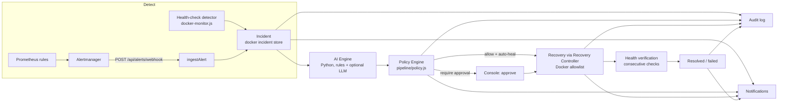

# Architecture (as implemented)

- **Running Docker flow:** `backend/docker-monitor.js` detects, opens incidents, restarts through the Recovery Controller and verifies. `backend/pipeline/index.js` hooks in: it asks the AI engine, evaluates policy, records everything in the audit log, notifies, optionally auto-heals, and blocks approvals that the policy denies.
- **Generic pipeline modules** (`orchestrator.js`, `lifecycle.js`, `executors/`): a platform-neutral version of the same loop with the six-state incident lifecycle, retries within policy and a Kubernetes executor. It is tested end to end but **not yet mounted on the HTTP server**; moving the Docker flow onto it is the main remaining integration step.
- **Recovery Controller:** the only process with the Docker socket; allowlisted stop/start/restart/logs.
- **Observability:** Prometheus (alert rules), Alertmanager, Loki, Promtail, Grafana.
- **Planned, not implemented:** MySQL persistence, Kubernetes onboarding agent, dependency map, OpenAPI spec, email notifications.
